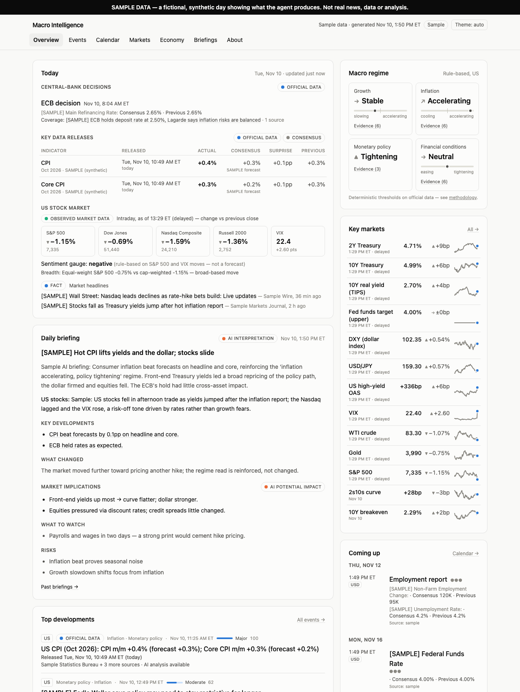
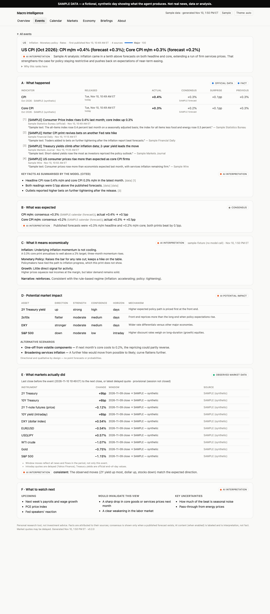
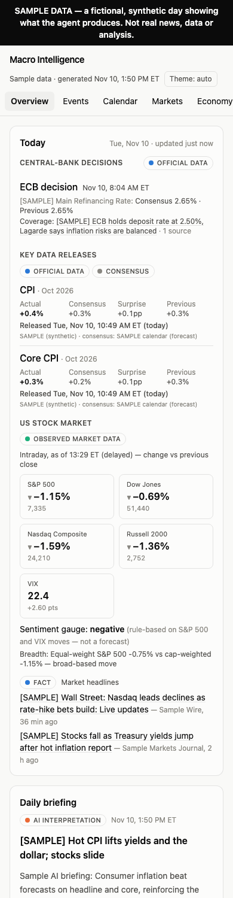
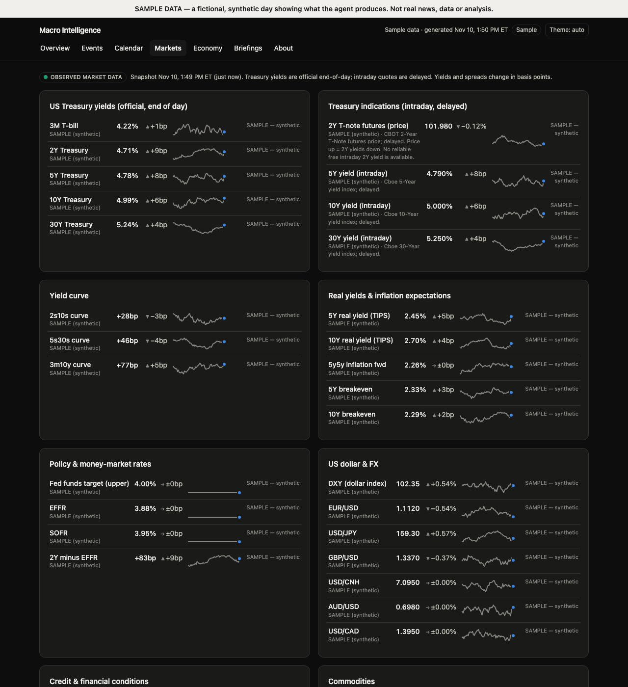

# Macro Intelligence Agent

A personal **macroeconomic intelligence website** that builds itself every weekday: it takes macro news,
official economic data, central-bank decisions and market prices, works out what is genuinely new and
important, and (optionally) uses an LLM to explain the economics and the cross-asset transmission — while
keeping **facts, published consensus, AI interpretation, AI potential impact and observed market moves
strictly separate and labeled**.

This repository is the agent's **processing, analysis and website** engine plus a synthetic sample day.
It contains **no data-collection code**: you plug in your own collectors for the sources you choose
([docs/COLLECTORS.md](docs/COLLECTORS.md)).

**[Live demo](https://claireee12321.github.io/macro-intelligence-agent/)** — the real website running on a
fictional, clearly labeled *sample day* (no real data is published from this repository).



## What you get each morning

The overview answers, in order:

1. **Today** — central-bank decisions in the last 24 h, fresh data releases (actual vs published forecast,
   surprise, previous, *and when it was released*), and a high-level read of the US stock market.
2. **Daily briefing** — what happened, what changed, market implications, what to watch.
3. **Macro regime** — growth, inflation, monetary policy and financial conditions, each from transparent
   threshold rules on official data (click for the evidence).
4. **Top developments**, **key markets** and **what's coming up**.

Every important event opens into the analytical spine:

| | Section | Content type |
|---|---|---|
| A | What happened | **Fact** (attributed sources) · **Official data** |
| B | What was expected | **Consensus** (published forecast, source named — or "unavailable") |
| C | What it means economically | **AI interpretation** |
| D | Potential market impact | **AI potential impact** — direction, relative strength, confidence, horizon, mechanism; no point forecasts |
| E | What markets actually did | **Observed market data** over an explicit window, with caveats |
| F | What to watch next | **AI interpretation** — upcoming catalysts, invalidation triggers, uncertainties |

<p>


</p>



## Principles

- **Macro first.** US focus; other G10 economies and China appear only when something material happens there.
  Equities only as broad cross-asset context — no stock picks or trade recommendations.
- **Never invent numbers.** Consensus comes only from a published forecast (never the previous value);
  actuals only from official data; observed moves only from market data. LLM text never supplies displayed numbers.
- **No false precision.** Impacts are qualitative (direction, strength, low/medium/high confidence, horizon,
  mechanism) — no "10Y +8bp" predictions or made-up probabilities.
- **Real-time honesty.** Every value carries its source and time; stale data is flagged; first prints are kept
  separate from revised data.
- **Cost-aware AI.** Only new or materially changed important events are analysed, under per-run, per-day and
  USD caps. A full data-only mode works with no LLM at all.

## How it works

```
 your collectors (bring your own)  ─┐   news items · economic series · calendar · market quotes
   or SampleCollectors (synthetic)  ├─► dedup → classify → score → cluster into events
                                    ┘     → official releases vs labeled consensus
                                          → observed reactions → rule-based macro regime
                                          → [optional LLM: event analysis + daily briefing]
                                          → JSON bundle → static React website
```

Python pipeline (`src/macro_intel/`), static React + TypeScript + Tailwind site (`web/`), scheduled with
GitHub Actions. Design details: [docs/ARCHITECTURE.md](docs/ARCHITECTURE.md).

## Try it

Requirements: Python ≥ 3.11 and Node ≥ 20.

```bash
git clone https://github.com/Claireee12321/macro-intelligence-agent.git && cd macro-intelligence-agent
python -m venv .venv && .venv/bin/pip install -e ".[dev]"

# 1) The sample day (no network, no keys) — exactly what the live demo shows
.venv/bin/macro-intel sample
cd web && npm install && MACRO_SITE_DIR=../data-sample/site npm run dev     # http://localhost:5173

# 2) Your own data: implement collectors (see docs/COLLECTORS.md), then
MACRO_COLLECTORS=my_collectors:MyCollectors .venv/bin/macro-intel run   # → data/site/*.json
cd web && npm run dev
```

Useful commands: `macro-intel status`, `macro-intel digest` (Markdown summary), `.venv/bin/pytest -q` (offline tests).

## Run it daily for yourself

1. Create a **private** copy of this repository (*Use this template* → Private) and add your collectors.
   Keep real data private: collected data often includes licensed third-party content.
2. Schedule `macro-intel run` (e.g. a GitHub Actions cron in your private repo), keep `data/state/` between
   runs, and build the site with `cd web && npm run build` (the bundle is copied into `web/dist/data`).
3. Host `web/dist` privately behind a login (e.g. Cloudflare Pages + Cloudflare Access).

## Optional AI analysis

Off by default. Set `LLM_PROVIDER=anthropic` and `ANTHROPIC_API_KEY` (or `openai_compat`) — see
[.env.example](.env.example) for the per-run, per-day and USD budget caps. Outputs are schema-validated
structured objects; references the model cites must exist in its inputs.

## Data and licensing

This repository contains **no collected data and no data-collection code** — only the engine, configuration
templates and a synthetic sample. The author's own deployment uses free official and media sources (central
banks, statistics agencies, Treasury and Fed data, an economic calendar, delayed quotes); several of those
restrict redistribution, which is why neither the data nor the collectors are published here. Check the terms
of any source you connect.

## Project docs

[Product spec](docs/PRODUCT_SPEC.md) · [Architecture](docs/ARCHITECTURE.md) · [Implementation plan](docs/IMPLEMENTATION_PLAN.md) ·
[Progress log](docs/PROGRESS.md) · [Baseline audit](docs/AUDIT.md) · [Agent instructions](AGENTS.md)

This project was built with an AI coding agent working through explicit milestones and review checkpoints;
the docs above are its working record.

## Disclaimer

A personal research tool, not investment advice. Market quotes may be delayed. AI content is interpretation,
not fact, and is labeled as such.

## License & attribution

MIT. This project began as an import of [MarketBrief](https://github.com/yukipanpan/marketbrief) by yukipan
(Copyright (c) 2025 yukipan); the original license is preserved in [LICENSE](LICENSE). Reused components
(RSS fetching, title normalisation, Yahoo/Frankfurter market fetchers, Forex Factory calendar parsing, FRED
fetcher, retry helper) are noted in the corresponding module docstrings.
